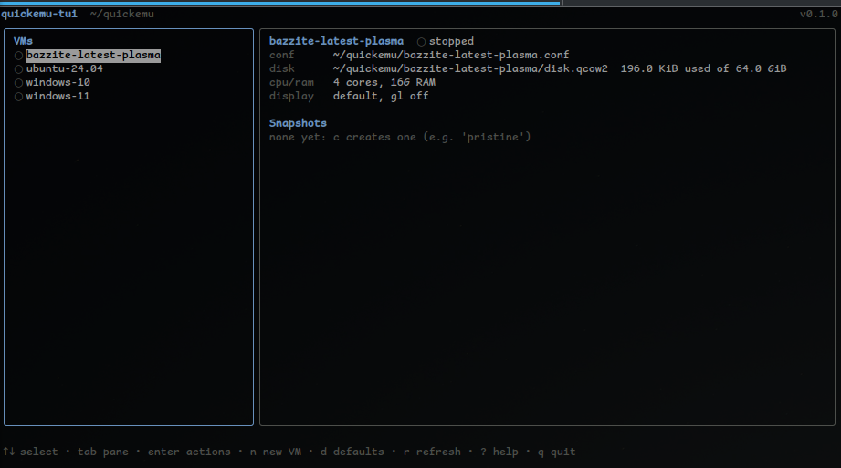
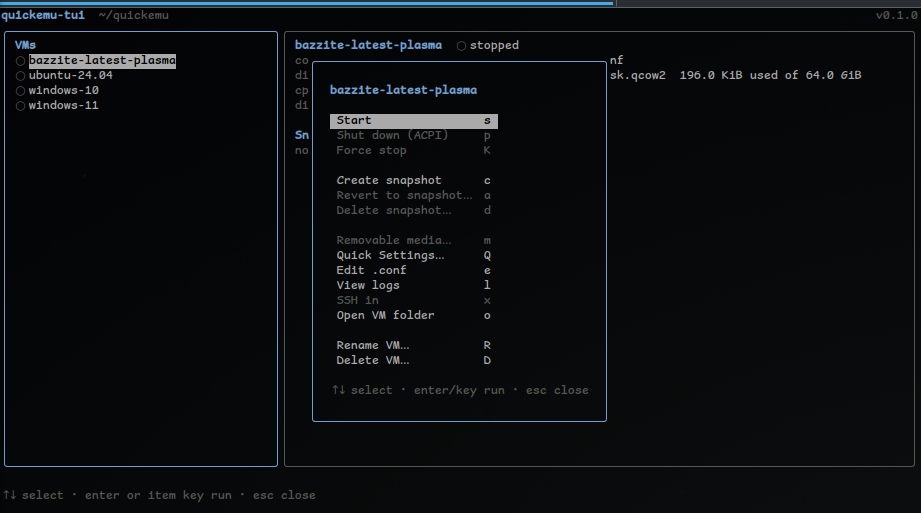
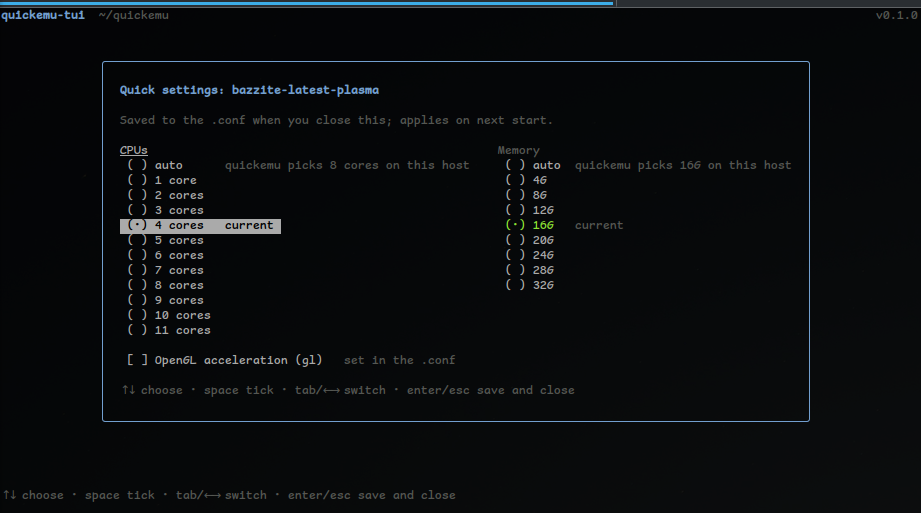
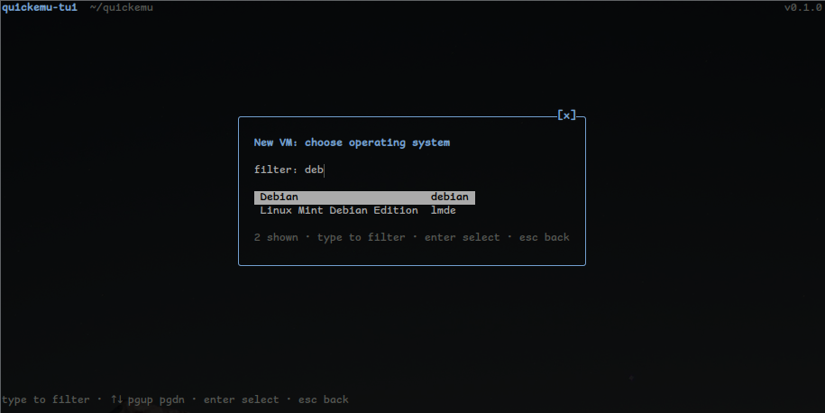
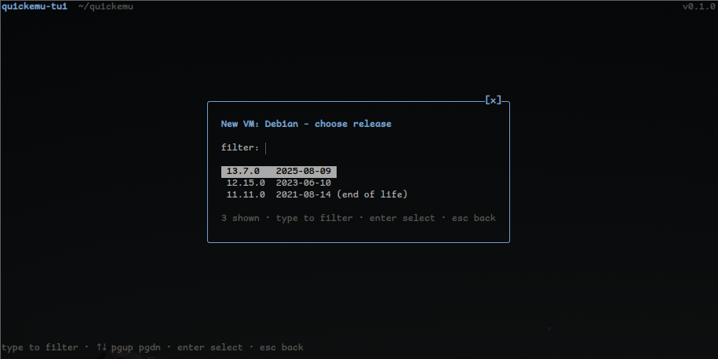

# quickemu-tui

A terminal UI for [quickemu](https://github.com/quickemu-project/quickemu) VMs,
focused on the "disposable test box" loop: start, poke, shut down, revert to
`pristine`, repeat.

Main screen


Virtual machine settings


Quick settings


New Guest



## Build

```bash
go mod tidy          # resolves go.sum (and toolchain, if a dep needs newer Go)
go test ./...        # core logic: conf parsing, monitor protocol, parsers
go build -o quickemu-tui .
```

`make dist` (optionally `GOOS=darwin GOARCH=arm64 BUILD=7`) builds a zip like
`dist/quickemu-tui-0.1.7-macos-arm64.zip`. CI (`.github/workflows/build.yml`)
does this for Linux and macOS on amd64 and arm64, and each push to `master`
publishes a release: the version is `VERSION` (major.minor, bump by hand) plus
the CI run number. `quickemu-tui -version` prints it with the commit and build
time, e.g. `quickemu-tui 0.1.57 (c84a1bb6abd5, built 2026-10-02T13:23:26Z)`; a
build from uncommitted changes shows `-dirty` after the commit.

To upgrade an installed copy, run `quickemu-tui --upgrade`: it downloads the
latest GitHub release for your platform, checks it against the release's
`SHA256SUMS`, confirms the new binary runs, and only then replaces the old one
(in place, keeping its permissions). It does nothing if you're already on the
latest. The binary has to be in a directory you can write to; otherwise run it
with `sudo`.

Run it from anywhere:

```bash
./quickemu-tui                 # defaults to ~/quickemu
./quickemu-tui ~/vms           # or -dir ~/vms
./quickemu-tui -quickemu /opt/quickemu/quickemu
./quickemu-tui -no-mouse       # leave the mouse to the terminal
```

Needs `quickemu` and `qemu-img` on `PATH`. `xdg-open` and `ssh` are only used
by their respective keys.

## Keys

| key | action |
| --- | --- |
| ↑/k ↓/j, tab | move; switch between VM list and snapshot list |
| r, ?, q | refresh, help, quit (VMs keep running after you quit) |
| d | edit default VM options (see below) |
| n | install a new VM with `quickget` (see below) |
| enter | open the actions menu for the selected VM (↑↓ then enter runs one; esc closes) |

In a dialog with several fields (quick settings, the custom ISO's settings),
tab and shift-tab move between the fields and ↑↓ change the choice in the one
you're on; the side arrows aren't used.

The mouse works too: click a VM to select it, and click it again (or
right-click it) for its actions menu, where clicking an item runs it and
clicking outside closes it. Clicking a snapshot selects it, quick settings
takes clicks on its choices and checkbox (clicking outside saves and closes),
and the wheel scrolls whatever list is under it. Every dialog has a close
button, `[x]` at the top right, which does what esc does there (the install
picker closes rather than stepping back). Dialogs that ask something have
buttons that press the key they stand for: `[ Save ]` in quick settings, `[ Next ]`
or similar in the text prompts (snapshot tag, rename, SSH user, image path, the
custom ISO's questions), `[ Yes ]` and `[ No ]` in every confirmation, and
`[ Background ]` and `[ Cancel ]` on the install progress dialog. In the
install picker a click on a row chooses it, and on the custom ISO's settings a
click on a row selects it and on its `‹` or `›` changes it. While the TUI has the mouse,
most terminals still select text with shift held; `-no-mouse` turns it off.

The keys below are shortcuts that work **inside the actions menu only**: pressing one is the same as choosing its item.

| key | action |
| --- | --- |
| s / p / K | start / ACPI shutdown / force stop (`quickemu --kill`, falls back to monitor `quit`); on a running VM that was started with SPICE, `s` opens a SPICE viewer on it again (`spicy`, else `remote-viewer`; Linux only), as closing the viewer leaves the VM running |
| c / a / d | create snapshot / revert / delete: `a` opens a picker (enter reverts, `s` reverts then starts, both after confirming); `d` opens a checklist (space ticks, `a` ticks all, enter deletes the ticked ones after confirming) |
| m | removable media: swap or eject ISOs on a running VM |
| Q | quick settings: pick the number of CPUs and the memory (the same choices as a new install, or `auto`), the display (`auto`, 800x600, 1024x768, 1920x1080 or fullscreen), tick OpenGL on or off and tick SPICE display on or off (`display="spice"`, or the key removed); on closing, what changed is written to the `.conf` (`cpu_cores=`/`ram=` set, or removed for `auto`; `width=`/`height=` for a size, or `fullscreen="on"`, which quickemu-tui passes to quickemu as `--fullscreen`; `gl="on"`/`"off"`), applying on the next start |
| e | edit the `.conf` in `$VISUAL`/`$EDITOR` (nano if unset) |
| l | logs: quickemu's log, the launch output, the generated launch script |
| x | ssh in via the forwarded port |
| o | open the VM folder |
| R | rename the VM: its `.conf`, its folder and the paths in the `.conf` that point into it (not while it runs) |
| D | delete the VM: its `.conf` and its folder, after a confirmation that lists exactly what goes (not while it runs) |

## Installing a new VM

Press `n`. The list of what can be installed comes from `quickget --list-csv`
(so it matches your installed quickemu). That command takes minutes, so the
result is cached in `~/.cache/quickemu-tui/catalog.csv` and refreshed in the
background once it's a week old. Releases are listed newest first, with their
release dates (and whether they're past end of life) from
[endoflife.date](https://endoflife.date) where it knows the system; those are
cached in `~/.cache/quickemu-tui/release-dates/` and refreshed weekly too.

Release builds carry a copy of both, made when they were built, so a first run
doesn't wait: it's copied into the cache at startup, dated when the copy was
made, and refreshed from your own quickget once that's a week old. A build without that
copy (such as a local `make build`) waits for quickget on its first run
instead. Deleting `~/.cache/quickemu-tui` starts afresh. A failed refresh is
silent while there's a cached list to use. Pressing `q` during a refresh asks
whether to abort it; by default the app waits for it to finish (so it's
cached) and then quits. `ctrl+c` quits at once. Pick an OS (type to filter),
a release, and an edition if there is one. Then choose the number of CPUs
(1 to one less than the host's logical CPUs) and the memory (4G steps up to
about half the host's RAM), or leave either on `auto`, where quickemu sizes the
VM from the host each time it starts (both steps show quickemu's table, with
your host's row marked). A choice is written to the new `.conf` as
`cpu_cores=`/`ram=`, overriding anything quickget wrote there and any default
option for the same key. If `spicy` is installed, a new VM (from quickget or a custom ISO) also gets
`display="spice"`, which lets its window be scaled to fit your screen; it's left
out if your default options set a `display` of their own, and quick settings can
switch it off. Then confirm. `quickget` runs in
your VM directory and the new VM appears in the list when it finishes.

A progress dialog shows a bar and percentage (parsed from curl's progress
output), and for a download, a copy or a checksum check also the speed
(averaged over the last several seconds, and shown once there are two seconds
of it) and the time left; the header shows the speed too. For a download the
percentage and the time left come from how much has arrived and the total the
server's headers give (so they're right after a resume too). That goes for a
quickget install as well: the curl wrapper it runs through (below) tells
quickemu-tui which file each of quickget's downloads is going to and keeps its
headers, so a new download (quickget fetches more than the image for some
systems) starts measuring again, and the time left is for the download in
progress, not unpacking and checking afterwards. Where there is no total (a
server that sends none) or no file to watch, curl's percentage is used, and
then there is a time left (from how fast the percentage climbs) but no speed,
and only from the first percent on. curl's own 100%, which it shows first when
it resumes, is ignored. `esc` keeps the download running in the background, with its progress
in the header, and `n` brings the dialog back. `c` cancels; partial downloads
are kept, so installing the same thing again resumes it. If the connection
drops or stalls mid-download (e.g. curl's `HTTP/2 stream … was not closed
cleanly`), quickemu-tui resumes it from where it stopped, up to 5 times, 5
seconds apart, before letting it fail. quickget itself would delete the partial
file and fail at once, so quickemu-tui puts a small curl wrapper first on
quickget's `PATH` that reruns only its `--continue-at -` download calls. Quitting during an
install asks first. If `quickget` exits 0 but printed errors (it does this
after a failed unzip), the install is reported as having problems rather than
as a success.

When an install finishes, the new VM's installation images are checked: the
files its `.conf` names with `iso=` / `fixed_iso=`, plus any `*.iso` in its
folder. A real image has an ISO 9660 (or UDF) signature at byte 32768; a vendor
that has moved its download typically leaves a saved web page under the `.iso`
name instead (Windows is the usual offender). If an image is missing or isn't a
real ISO, a dialog gives its full path, what is wrong with it, and tells you to
download a genuine ISO and save it at that path (or edit `iso=` in the `.conf`).
The VM is still created.

### A system quickget doesn't list

The first row of the system list is **Custom ISO…**, for an installation image
you have, or can name, that quickget doesn't know. It asks for:

1. the image: a file on this machine (`~` works), or an `http(s)` URL. A URL is
   downloaded with curl, with the same progress dialog, retries and resuming as
   a quickget install, and redirects are followed: the link a browser's
   download button uses ("…/distro.iso/download", which redirects to a mirror)
   works, and the image is named after where the redirects end up. The
   address of a SourceForge project page becomes that project's latest
   download. Only `http` and `https` are followed, and an `https` address can't
be redirected to plain `http`. Whatever arrives must pass for an ISO (a `.img` is exempt), so a
   web page where the download should be is refused with that explained, and
   nothing is left to resume. A file is copied, and the original is left where
   it is (a message says so, and that you may delete it);
2. a name for the VM, suggested from the file name;
3. a SHA-256 checksum, optionally: paste the digest, the line from the
   distro's `SHA256SUMS`, or the address of the checksum file (redirects are
   followed there too; if it lists several images, the line naming the image
   is used). It's checked once the image is here, and a mismatch
   deletes the image and creates no VM. Leaving it blank works, but the
   confirmation and the finished message say the image wasn't checked;
4. the system type (`guest_os`), boot mode and disk size, on one screen with
   `linux`, `efi` and `32G` already chosen (enter accepts them). The system
   type isn't a label: quickemu picks the virtual hardware from it, and an
   unknown value quietly gets a generic profile, so only the values quickemu
   treats specially are offered (not `macos`, which needs more than an ISO).
   Boot is written as exactly `efi` or `legacy`, because quickemu reads
   anything without "efi" in it as legacy;
5. the CPU and memory steps of an ordinary install.

If `<name>/disk.qcow2` already exists (a leftover from a VM whose `.conf` is
gone), the confirmation warns that the new VM will use it and installing will
overwrite what's on it, and enter then means no. An image that finished
downloading is remembered (in `<name>/.quickemu-tui-fetch`) until the VM is
made, so trying again after a later failure doesn't download it again.

The image goes into `<name>/` beside the new `<name>.conf`, which gets
`guest_os`, `boot`, `disk_size`, `disk_img` and `iso`, then your CPU and memory
picks and your default options. A copy is refused if the file isn't a genuine
ISO or the disk hasn't room for it. An interrupted download is kept as
`<file>.part` and resumes if you start the same one again. The row appears
once the list of systems has loaded.

## Deleting a VM

`D` in the actions menu removes the `.conf`, the VM's folder (where its disk
lives, with everything in it) and the desktop shortcut quickemu may have made,
after a confirmation listing each path and the folder's size. It is never done
to a running VM. The folder is only removed if it is a real directory inside
your VM directory that no other VM uses: if a VM's disk sits directly in the VM
directory, outside it, behind a symlink, or is shared, only the `.conf` is
removed and the confirmation says what was left and why.

## Default VM options

Some settings are needed on every VM on a given machine (for example
`gl="off"` when quickemu shows nothing with GL on). Press `d` to list them,
one `key="value"` per line, as they'd appear in a `.conf`; `ctrl+s` saves. They
are stored in the user config file (`default_conf`, next to `vm_dir`).

- **New VMs** get all of them added to their `.conf` when `quickget` finishes.
- **Existing VMs** get the ones their `.conf` doesn't already set, when you
  start them. A value the VM sets itself always wins, so an explicit
  `gl="on"` is never overwritten. (A commented-out `#gl="on"` counts as unset.)

Because quickemu runs the `.conf` as a bash script, only plain assignments are
accepted: lines with `;`, `&`, `|`, redirections, backticks or `$(...)` outside
quotes are rejected.

## How it works

All VM logic is in `internal/qemu` (no UI imports); `internal/tui` is the
Bubble Tea layer. Every slow call runs in a `tea.Cmd`, so the UI never blocks,
and `View()` does no IO.

- **Run state** comes from the HMP monitor socket quickemu creates
  (`info status`), with the pid file as a fallback. A leftover socket with
  nobody listening counts as stopped. A live qemu whose monitor doesn't answer
  shows as *monitor busy*: the monitor serves one client at a time, so an open
  `socat` session causes this.
- **Snapshots** are qcow2 internal snapshots via `qemu-img snapshot`. Create,
  revert and delete re-check that the VM is off right before running, since
  qemu-img on a live disk is how you corrupt it. Listing uses
  `qemu-img info -U --output=json`, which also works while the VM runs.
- **Launching** runs quickemu in its own session with output going to
  `<vm>/<name>.tui-launch.log`, not a pipe (qemu inherits those descriptors and
  would SIGPIPE once the TUI exits). A launching VM counts as "up", so you can't
  snapshot it mid-boot.
- **Media** swaps use the monitor's `change`/`eject -f`. Paths containing
  whitespace are rejected, because HMP can't take them.

## Assumptions worth checking on a real install

These are based on quickemu 4.9's file layout, not verified against its source:

- the pid file is `<vm_dir>/<name>.pid` (only the fallback; the monitor is primary)
- a running VM's SPICE endpoint is read from the `-spice` option on its qemu command line (`/proc/<pid>/cmdline`, so Linux only; the pid is in `<name>.pid`): `unix=on,addr=<socket>` (relative to the `.conf`'s folder) or `port=<n>`
- `<name>.ports` lines look like `ssh,22220` (a line whose value isn't a plain port, like `unix,<vm>/<vm>.sock`, is ignored)
